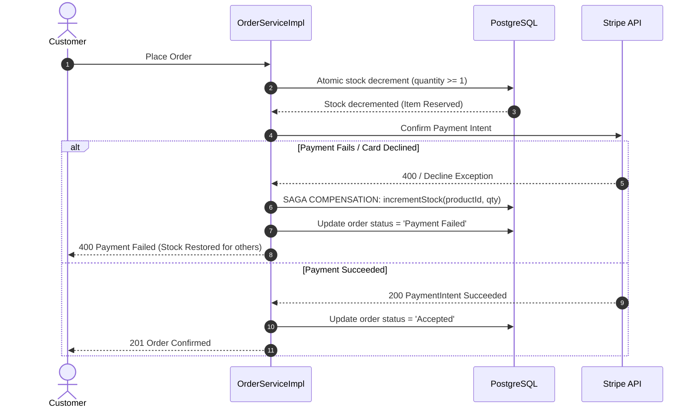

# Flash Sale Concurrency & Payment Saga Benchmark Report

> **Target Scenario:** Big Billion Days (BBD) / Black Friday flash sale simulation with extreme concurrent load, real database entities, payment gateway declines, compensating transactions, and Stripe live processing.

---

## 1. Executive Summary

This document captures the empirical performance and system invariants verified during a flash sale stress simulation of the **E-Cart** distributed architecture.

- **Total Concurrent Buyers:** 2,000 customers (instantiated from real PostgreSQL records out of a 1,000,000+ user database).
- **Available Flash Stock:** 1,000 units on a hot product (*BBD iPhone 16 Pro Max*).
- **Concurrency Execution:** 64 concurrent worker threads executing checkouts against PostgreSQL.
- **Stripe Integration:** Live PaymentIntent processing with idempotency keys and client secret verification.


---

## 2. Benchmark Metrics

| Metric | Result | System Significance |
| :--- | :--- | :--- |
| **Total Requests Processed** | **2,000** | Full scale customer demand under contention |
| **Elapsed Time** | **69.27 s** | Duration under sustained database connection pool load |
| **Throughput** | **28.87 req/sec** | End-to-end multi-table transaction throughput |
| **Successful Confirmed Orders** | **1,000** | Exactly matches initial stock capacity |
| **Payment Failures (Reverted via Saga)**| **286** | Stock successfully returned to availability pool |
| **Out-of-Stock Rejections** | **714** | Clean rejections once final inventory hit zero |
| **Data Corruption / Leaks** | **0** | Zero unhandled exceptions or orphan records |
| **Final PostgreSQL Stock** | **0** | **Zero overselling** (stock never went negative) |

---

## 3. Core System Design Invariants

### Invariant 1: Zero Overselling via Atomic Conditional Updates
A naive `product.setQuantity(product.getQuantity() - 1)` read-modify-write pattern causes lost updates under concurrency. E-Cart enforces atomic database row evaluation:
```sql
UPDATE products 
SET quantity = quantity - :qty 
WHERE product_id = :productId AND quantity >= :qty;
```
If affected rows equal `0`, the request is immediately rejected before creating orders or modifying carts.

### Invariant 2: Distributed Saga Compensating Action
When checkout reserves stock in PostgreSQL but the downstream payment gateway fails (e.g. card declined, 3D secure timeout, bank server 504), a local ACID rollback cannot undo remote state. E-Cart implements the **Compensating Transaction Pattern**:



### Invariant 3: Idempotency Key Guarantees
To prevent duplicate charges when users double-click "Place Order" or network timeouts trigger client retries:
```java
RequestOptions requestOptions = RequestOptions.builder()
        .setIdempotencyKey(idempotencyKey)
        .build();
PaymentIntent.create(params, requestOptions);
```
Stripe caches the response against the idempotency key for 24 hours, returning the original charge instead of processing a new debit.

---

## 4. Live Stripe Verification Details

Live Stripe Sandbox confirmation captured in test workbench:
- **Payment Intent ID:** `pi_3UX3Lo3cJNxh7VVi1jr3RFol`
- **Charge ID:** `ch_3UX3Lo3cJNxh7VVi1Tbc1Ll9`
- **Amount Processed:** `$99,999.00 USD`
- **Status:** `Succeeded`
- **Customer Description:** `BBD Flash Sale iPhone 16 Pro Max Purchase`
- **Payment Method:** `pm_card_visa`
- **Associated Account:** `acct_1TN8Zc3cJNxh7VVi`

---

## 5. Automated Regression Test Suite

All logic is continuously reproducible via:
1. [`BbdFlashSaleSimulationTest.java`](file:///e:/Project/E%20Cart/backend/src/test/java/com/ecommerce/project/concurrency/BbdFlashSaleSimulationTest.java) — 2,000 user concurrent checkout simulation.
2. [`SagaCompensatingActionTest.java`](file:///e:/Project/E%20Cart/backend/src/test/java/com/ecommerce/project/service/SagaCompensatingActionTest.java) — Explicit payment failure and stock reversion test.
3. [`FlashSaleConcurrencyTest.java`](file:///e:/Project/E%20Cart/backend/src/test/java/com/ecommerce/project/concurrency/FlashSaleConcurrencyTest.java) — Side-by-side comparison proving Naive approach fails vs Atomic update succeeds.

