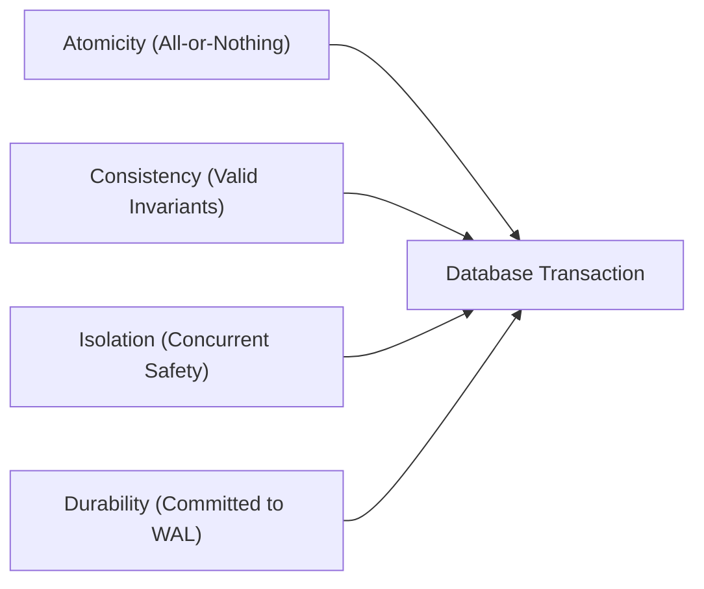
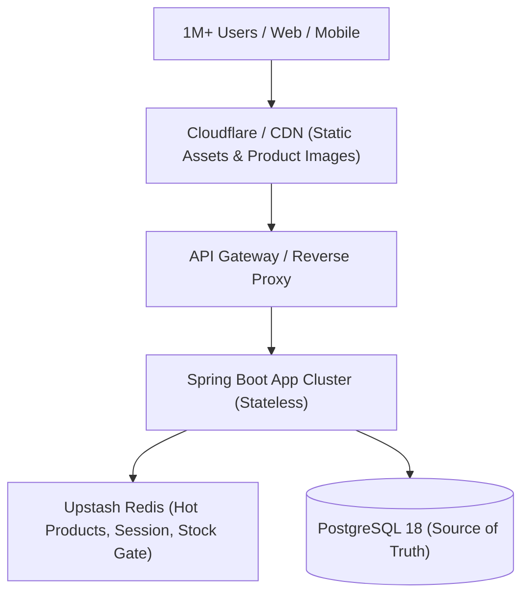
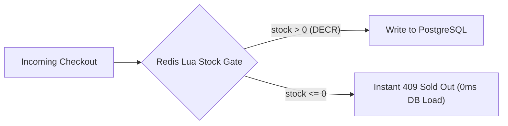
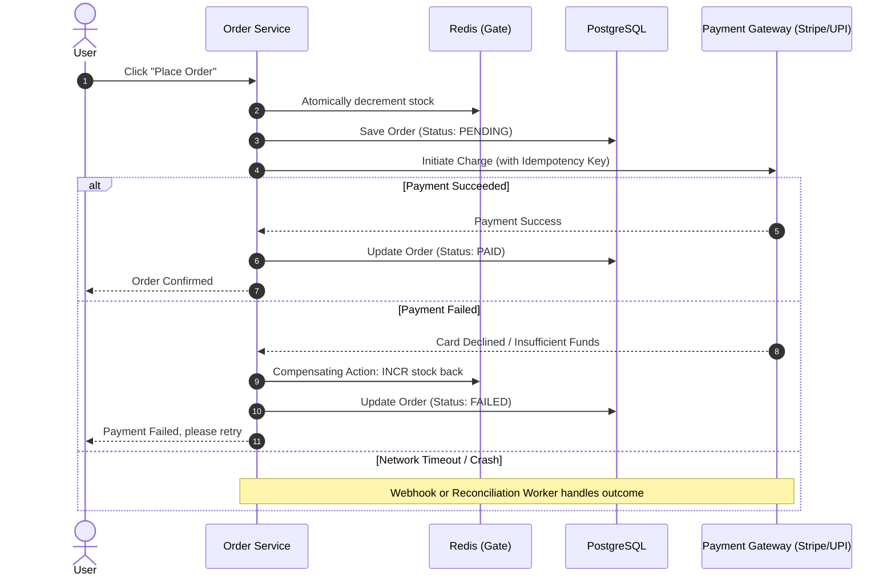

# E-Commerce System Design & Interview Architecture Guide

This document breaks down the foundational system design concepts, distributed transaction patterns, and concurrency control mechanisms used in modern high-scale e-commerce platforms like Flipkart and Amazon, mapped directly to what you are building in **E-Cart**.

---

## 1. How E-Cart Demonstrates ACID Properties

In a relational database (PostgreSQL), ACID guarantees transactional reliability:



### 1.1 Atomicity ("All or Nothing")
* **The Problem:** Placing an order involves deducting money, deducting stock, creating an `Order` row, and clearing items from the `Cart`. If the server crashes halfway through, money might be deducted while stock is not.
* **How you achieve it:** 
  - In Spring Boot, annotate service methods with `@Transactional`.
  - Spring wraps database operations in a single database transaction block: `BEGIN ... COMMIT`.
  - If any checked or runtime exception is thrown (e.g., out-of-stock), Spring triggers `ROLLBACK`, restoring all rows to their original states.

### 1.2 Consistency ("Rules & Invariants are Preserved")
* **The Problem:** The database must never contain negative stock, orphan order items without a parent order, or invalid price formats.
* **How you achieve it:**
  - **Schema Constraints:** `CHECK (quantity >= 0)`, `FOREIGN KEY` constraints (e.g., `FOREIGN KEY (product_id) REFERENCES products(product_id)`), and `NOT NULL` columns.
  - **Application Validation:** Spring's `@Valid` combined with JSR-380 annotations (`@Min`, `@NotBlank`, `@Positive`) checks invariants before SQL execution.

### 1.3 Isolation ("Concurrent Execution Safety")
* **The Problem:** Two buyers simultaneously attempt to buy the last remaining unit of an iPhone.
* **How you achieve it:**
  - PostgreSQL default isolation level is **`READ COMMITTED`**.
  - To prevent overselling, you enforce isolation through:
    1. **Pessimistic Locking:** `SELECT * FROM products WHERE product_id = :id FOR UPDATE;` (places an exclusive row lock; the second transaction waits until the first commits).
    2. **Atomic Conditional Update:** 
       ```sql
       UPDATE products 
       SET quantity = quantity - :qty 
       WHERE product_id = :id AND quantity >= :qty;
       ```
       PostgreSQL evaluates row locks at the engine level during single-statement updates.

### 1.4 Durability ("Committed Data Survives Crashes")
* **The Problem:** Once a purchase confirms, a power cut or operating system crash cannot erase the order record.
* **How you achieve it:**
  - PostgreSQL writes all transaction changes to the **WAL (Write-Ahead Log)** on non-volatile disk before returning a success signal to the client.
  - On restart, PostgreSQL replays the WAL to recover unwritten data pages in RAM.

---

## 2. Serving 1 Million+ Users: The Scaling Strategy

Having 1,000,000 users in your database presents different challenges across read and write pathways:



### 2.1 Stateless Architecture & Horizontal Scaling
* **Stateless JWTs:** User authentication uses self-contained signed JWT tokens rather than server-side HTTP sessions stored in memory (`HttpSession`). Any application server instance can validate requests independently without inter-instance session synchronization.
* **Horizontal Scaling:** When traffic spikes, additional Spring Boot instances can be spun up behind a round-robin load balancer without architecture changes.

### 2.2 Database Query Optimization
When tables have 4,000,000 orders and 1,000,000 users, full table scans (`Seq Scan`) cause CPU spikes and timeouts.
* **B-Tree Indexing:** Index foreign keys and search columns:
  ```sql
  CREATE INDEX idx_orders_user_id ON orders(user_id);
  CREATE INDEX idx_products_category ON products(category_id);
  CREATE INDEX idx_orders_created_at ON orders(order_date);
  ```
* **Query Plan Analysis:** Use `EXPLAIN ANALYZE` before and after adding indexes:
  - Without Index: `Seq Scan on orders (cost=0.00..85420.00 rows=4000000)` (Takes seconds)
  - With Index: `Index Scan using idx_orders_user_id (cost=0.43..8.45 rows=5)` (Takes milliseconds)
* **Pagination:** Enforce pagination (`Pageable` in Spring Data JPA) on all query endpoints to prevent loading 100,000 rows into JVM heap memory simultaneously, which would trigger `OutOfMemoryError` and GC thrashing.

---

## 3. Where and Why Redis is Used in Modern E-Commerce

Redis is an in-memory key-value data store capable of sub-millisecond read/write operations (100k+ operations/second per node).



### 3.1 Use-Case 1: Flash-Sale Stock Gate (High Contention Protection)
* **The Problem:** 50,000 users try to buy 100 units of a heavily discounted phone in 2 seconds. If all 50,000 requests hit PostgreSQL directly, connection pools exhaust, database CPU reaches 100%, and the site crashes.
* **The Redis Solution:**
  1. Pre-warm Redis with the available stock count: `SET product:51:stock 100`.
  2. Each checkout request executes an atomic decrement (`DECR` or a Lua script):
     ```lua
     local stock = redis.call('get', KEYS[1])
     if tonumber(stock) > 0 then
         redis.call('decr', KEYS[1])
         return 1
     else
         return 0
     end
     ```
  3. The first 100 requests receive `1` and proceed to place the order in PostgreSQL.
  4. The remaining 49,900 requests receive `0` and fail immediately at the Redis layer within 1ms, shielding PostgreSQL from 99.8% of load.

### 3.2 Use-Case 2: Caching Read-Heavy Catalogs (Cache-Aside Pattern)
* E-commerce traffic typically has a **95:5 Read-to-Write ratio**.
* Frequently visited category lists and top products are cached in Redis with a TTL (e.g., 10 minutes):
  ```
  App -> Check Redis (Cache Hit? Return data in 2ms)
      -> Cache Miss -> Query PostgreSQL -> Store in Redis -> Return data
  ```

### 3.3 Use-Case 3: Distributed Rate Limiting & Cart Storage
* **Rate Limiting:** Protect APIs from bot scalpers using Redis sliding-window counters.
* **Ephemeral Carts:** Active cart sessions for non-logged-in users can live in Redis with expiration to keep the primary relational DB clean.

---

## 4. How Flipkart Handles Mega Sales, Payment Failures, and Stock Issues

Platforms like Flipkart (Big Billion Days) and Amazon (Prime Day) employ distributed systems patterns that go beyond single-database transactions:

### 4.1 The Payment Problem: Why ACID Transactions Aren't Enough
A database transaction **cannot encompass third-party payment gateways (Stripe, Razorpay, UPI)**. 
- You cannot execute `BEGIN TRANSACTION` -> charge the credit card -> `COMMIT`. 
- Network calls inside a database transaction hold locks open, causing connection pool starvation.
- If the card is charged but the server dies before database commit, money was taken without an order record.

### 4.2 The Solution: Saga Pattern with Compensating Actions
E-commerce platforms use the **Saga Pattern** (orchestration-based):



### 4.3 Idempotency Keys (Preventing Double Charges)
* If a network drops during checkout, the user frequently hits "Pay" again.
* The frontend generates a unique UUID `Idempotency-Key` sent in request headers.
* The payment gateway and backend store this key. If a second request arrives with the same key, it returns the cached result of the original charge rather than charging the card twice.

### 4.4 Stock Failure & Reconciliation Workers
* **What happens if a user abandons checkout after reserving stock?**
  - High-scale platforms implement an **inventory lease (TTL reservation)**:
    Stock reservation expires after 10-15 minutes if not paid.
  - A scheduled background worker checks for expired `PENDING` orders and restores the inventory via compensating actions.

---

## 5. System Design Interview Cheat Sheet

When an interviewer asks you about this project, structure your explanation around these key technical decisions:

1. **Architecture:** *"I built a layered Spring Boot architecture with PostgreSQL for relational integrity and Upstash Redis for low-latency caching and concurrency gating."*
2. **Handling Concurrency:** *"To prevent overselling during flash sales, I bypassed naive read-then-write logic and used single-statement atomic conditional updates in SQL (`WHERE quantity >= :qty`), preventing race conditions at the database engine level."*
3. **Handling Scale:** *"With over 1,000,000 users and 4,000,000 orders in the database, I indexed query paths, utilized pagination to protect JVM memory, and designed the application tier to remain stateless via JWTs for horizontal scaling."*
4. **Handling Payment Resilience:** *"Because distributed transactions cannot span third-party gateways, I implemented the Saga pattern with compensating rollback transactions and idempotency keys to guarantee financial and inventory consistency."*

