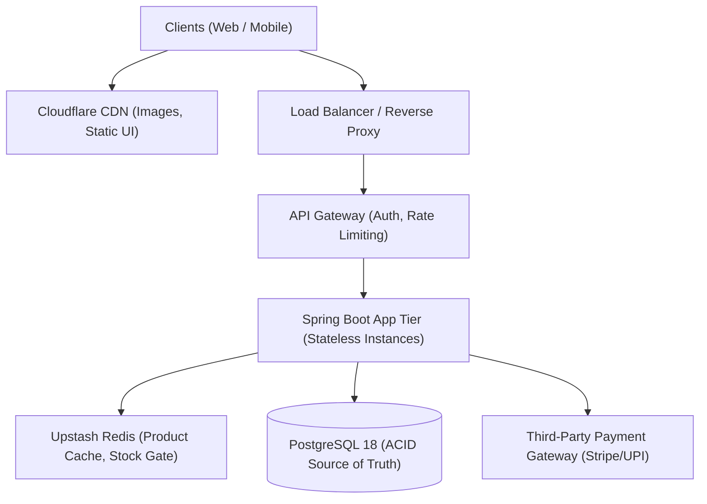

## Verification & Reliability Pipelines Quick Reference

For reproducible verification commands and execution guides for your technical portfolio, see:
- [`pipelines-runbook.md`](file:///e:/Project/E%20Cart/docs/pipelines-runbook.md) — Exact PowerShell commands to execute the Flash-Sale, Redis Stock Gate, and Stripe Reliability test pipelines.
- [`flash-sale-and-saga-benchmark.md`](file:///e:/Project/E%20Cart/docs/flash-sale-and-saga-benchmark.md) — 2,000-user BBD flash sale simulation metrics and live Stripe dashboard proofs.

---

# System Design Interview Playbook for E-Cart

This playbook provides the exact 4-step framework used by Senior Engineers to approach system design questions, specifically tailored to E-Commerce (Flipkart, Amazon) and your **E-Cart** project.

---

## The 4-Step System Design Interview Framework

```
┌────────────────────────────────────────────────────────┐
│ STEP 1: Clarify Scope & Non-Functional Requirements   │
├────────────────────────────────────────────────────────┤
│ STEP 2: High-Level Architecture & API Design           │
├────────────────────────────────────────────────────────┤
│ STEP 3: Deep Dives (Concurrency, Payments, Caching)    │
├────────────────────────────────────────────────────────┤
│ STEP 4: Bottlenecks, Trade-offs & Failure Modes        │
└────────────────────────────────────────────────────────┘
```

---

## Step 1: Clarify Scope & Non-Functional Requirements (First 5 mins)

Never jump straight into drawing boxes. Start by asking clarifying questions and stating your non-functional assumptions:

### Functional Requirements (Scope)
- Can users browse the product catalog and search by category?
- Can users add items to a cart, proceed to checkout, and pay?
- Does the system support flash sales with high concurrency?

### Non-Functional Requirements (Scale & Constraints)
- **Scale:** 1,000,000 active users, 100,000 products, 4,000,000 lifetime orders.
- **Traffic Profile:** E-commerce is **95% reads, 5% writes**. Browsing is read-heavy; checkout is write-heavy with extreme spikes during sales.
- **Consistency vs Availability (CAP Theorem):**
  - For **Product Catalog/Search**: High Availability (AP) – slightly stale prices or images for a few seconds are acceptable.
  - For **Stock & Payments**: Strong Consistency (CP) – **zero overselling** and **zero duplicate charges** are non-negotiable.

---

## Step 2: High-Level Architecture & API Design (Next 10 mins)

Draw the end-to-end request flow:



### Core API Endpoints
- `GET /api/public/products?page=0&size=20` (Paginated, cached via Redis)
- `POST /api/carts/products/{id}/quantity/{qty}` (Authenticated, user-scoped)
- `POST /api/order/users/payments/{method}` (Atomic checkout + payment saga)

---

## Step 3: Deep Dives into Core Technical Challenges (Next 20 mins)

Interviewers will drill down into these specific hard problems:

### 3.1 Concurrency Control (Flash-Sale Overselling)
* **Interview Question:** *"50,000 users click 'Buy' on 10 iPhones at the exact same second. How do you prevent stock from going negative?"*
* **How to Answer:**
  1. **Explain the Naive Failure:** "In a standard `findById()` followed by `save()`, all 50,000 threads read `stock = 10` concurrently before any thread writes back, causing 50,000 orders to be created for 10 units."
  2. **Solution A (Database Layer):** Use **Atomic Conditional Updates**:
     ```sql
     UPDATE products 
     SET quantity = quantity - :qty 
     WHERE product_id = :id AND quantity >= :qty;
     ```
     PostgreSQL evaluates the condition while holding the row lock during execution. If `updated_rows == 0`, the purchase is immediately rejected.
  3. **Solution B (In-Memory Shield Layer via Redis):** Under extreme contention (e.g., 50k RPS), database connection pools will exhaust. Use Redis `DECR` or a Lua script as a stock gate:
     - The first 10 calls return $\ge 0$ and proceed to PostgreSQL.
     - The remaining 49,990 calls return $< 0$ and are rejected in <1ms without touching PostgreSQL.

---

### 3.2 Distributed Payment Failures (Saga with Compensation)
* **Interview Question:** *"What happens if stock is deducted, but the payment gateway times out or the customer's card fails?"*
* **How to Answer:**
  - "ACID database transactions cannot span external network calls like Stripe or UPI. Holding a database transaction open during a 5-second payment call leads to connection pool starvation."
  - "Instead, we implement an **orchestrated Saga with compensating actions**:"
    1. **Reserve:** Decrement stock and create Order with status `PENDING`.
    2. **Charge:** Call payment gateway with an `Idempotency-Key` header (UUID) to ensure retries never result in duplicate charges.
    3. **Success:** Transition status to `PAID`.
    4. **Failure (Compensation):** Catch `PaymentException`, trigger a compensating update to restore inventory (`quantity = quantity + :qty`), and mark order as `PAYMENT_FAILED`.
    5. **Network Partition / Crash:** A scheduled reconciliation job queries Stripe for unsettled `PENDING` orders and restores abandoned reservations.

---

### 3.3 Database Scaling (Indexes & Sharding)
* **Interview Question:** *"Your orders table has 4,000,000 rows. How do you maintain sub-10ms query times?"*
* **How to Answer:**
  - **Index Design:** "A full table scan (`Seq Scan`) across 4M rows takes seconds. I created composite and B-Tree indexes on lookup keys like `(user_id, order_date)`."
  - **Evidence via EXPLAIN ANALYZE:** "I verify query performance using PostgreSQL `EXPLAIN ANALYZE`, verifying cost reductions from $O(N)$ full table scans to $O(\log N)$ Index Scans."
  - **Future Sharding:** "If order volume expands to hundreds of millions, we shard the database horizontally by `user_id` so that any given user's orders reside on a single shard."

---

## Step 4: Bottlenecks & Failure Modes (Last 5-10 mins)

Proactively address system limitations before the interviewer points them out:

| Component | Failure Mode | Mitigation Strategy |
| :--- | :--- | :--- |
| **Redis Cache** | Cache breakdown / Redis crash | Fallback directly to PostgreSQL conditional update (`quantity >= :qty`); the database remains the true source of truth. |
| **Payment Gateway** | Timeout or 504 Gateway Error | Webhooks asynchronously process the delayed payment confirmation; idempotent endpoints prevent double billing. |
| **PostgreSQL** | Connection pool exhaustion | HikariCP pool tuning (e.g., maximum 20-30 connections) combined with fast-failing Redis gates. |
| **User Authentication** | Heavy BCrypt CPU overhead during login | BCrypt takes ~100ms per verification by design. Protect login endpoints with Redis rate-limiting (e.g., 5 attempts/minute). |

---

## Quick Mental Model to Remember

```
"Read path: CDN -> Load Balancer -> Stateless Spring Boot -> Redis -> Postgres Read Replicas"
"Write path: Rate Limiter -> Redis Stock Gate -> Atomic SQL Update -> Payment Saga (Idempotent) -> WAL"
```

